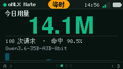

# oMLX Mate

> 把 oMLX 的用量和「省了多少钱」放到一块 240×135 的桌面小屏上。


oMLX Mate 是给 [oMLX](https://github.com/jundot/omlx) 用户的桌面伴侣：

- **设备只负责显示**：今日用量、DeepSeek 账单折算、当前模型、7/30 天趋势
- **Mac 端 agent 负责算账**：只读 `~/.omlx/usage.sqlite3`，按 DeepSeek 峰谷 + 缓存价精确折算
- **一条 `curl | bash` 安装**：设备自带安装脚本，自动装成 LaunchAgent，开机自启
- **本地控制台**：配置设备显示什么、显示多少页，远程翻页/改语言/重启
- **不把 oMLX 暴露到局域网**：Mac 主动推送，设备从不访问推理端口

| 用量 | 成本 | 控制台 |
|---|---|---|
|  |  |  |

---

## 为什么是「推送」而不是「设备直连」

oMLX 默认只监听 `127.0.0.1:8000`。让 StickS3 直接拉取，就必须改 oMLX 的监听地址、把推理服务暴露到局域网；而且设备还得记住 Mac 的 IP。

oMLX Mate 反过来：**Mac 端 agent 读本地 SQLite，算好账，每 5 秒 POST 一份 <2KB 的快照给设备**。

```
oMLX (127.0.0.1:8000)                StickS3 (ESP32-S3)
   │  usage.sqlite3 (只读)                │
   │  /api/status (本机)                  │
   ▼                                      ▼
~/.omlx-mate/agent.py  ──POST /api/snapshot──▶  6 种页面渲染
   (LaunchAgent 常驻)    ◀──state + cmd────────  A/B 翻页、休眠
   └── 127.0.0.1:<auto> 本地控制台
```

- 设备离线不影响数据：Mac 端持续计算，设备一上线就收到最新快照
- 命令借推送的响应下发，不需要 Mac 向设备开入站端口
- `.local` 名称优先，mDNS 抖动时 agent 自动解析 IP 重试

---

## 功能

**设备（M5StickS3）**

- 配网：AP + 二维码，只填 Wi-Fi，令牌自动生成
- 页面：省钱 / 用量 / 趋势 / 模型 / 成本 / 设备，按控制台配置渲染
- 交互：A 下一页、B 上一页；长按 B 重新配网
- 状态栏：峰/谷价、服务端时间、Wi-Fi 信号、电量
- 充电时常亮（仅变暗），电池供电 3 分钟熄屏
- 中英双语；OTA（ArduinoOTA）可用

**Mac 控制台（`http://127.0.0.1:<自动端口>`）**

- 今日 / 7 天 / 30 天省钱、tokens、缓存命中
- 30 天每日净省柱状图
- **显示配置**：增删页面、选类型/区间/图表、紧凑模式，带 240×135 预览
- **设备管理**：在线状态、电量、信号、当前页，远程翻页 / 闪烁 / 重启 / 移除
- 设置：对标模型（flash / pro）、币种、电价、功率、折旧、推送间隔、语言、局域网访问
- 日志

---

## 快速开始

### 1. 烧录固件

从 [Releases](https://github.com/andjiang0083/omlx-mate/releases/latest) 下载 `omlx-mate-v0.2.1-merged.bin`，用 M5Burner 或 esptool 写到 `0x0`；也可以本地编译：

```bash
pio run -e sticks3 -t upload --upload-port /dev/cu.usbmodem*
```

### 2. 配网

首次上电，屏幕显示二维码：

1. 手机连 `oMLX-Mate-XXXX`（密码 `omlxmate`）
2. 打开 `http://192.168.4.1`
3. 选 2.4G Wi-Fi、填密码、保存
4. 设备重启并连上 Wi-Fi

### 3. 安装 Mac agent

设备屏幕会显示：

```
http://omlx-mate-xxxx.local
```

在 Mac 上打开它，复制页面里的命令并在终端执行：

```bash
curl -sL http://omlx-mate-xxxx.local/setup.sh | bash
```

脚本会：

- 检查 `python3`（缺失时提示 `xcode-select --install`）
- 从设备下载 `~/.omlx-mate/agent.py`
- 写入 `~/Library/LaunchAgents/com.omlx.mate.plist` 并启动
- 立刻推送一次，然后打开控制台

**要求**：macOS、Python 3.9+、oMLX 先启动过一次（会生成 `~/.omlx/usage.sqlite3`）。

### 4. 完成

设备几秒内开始显示真实数据。控制台地址会打印出来，也会写到 `~/.omlx-mate/url.txt`（端口被占用时自动顺延）。

卸载：

```bash
curl -sL http://omlx-mate-xxxx.local/uninstall.sh | bash
```

---

## 显示配置

控制台里的配置是**全局**的：改一次，所有设备都按这个页面列表渲染。设备上的 A/B 只负责翻页。

页面类型：

| 类型 | 内容 | 可选区间 | 可选图表 |
|---|---|---|---|
| 省钱 | 净省大数字 + API/电费 + tokens/请求 | 今日/昨日/7 天/30 天 | 7 日/30 日/今日小时/无 |
| 用量 | tokens 大数字 + 请求/命中 + 当前模型 | 同上 | 同上 |
| 趋势 | 净省 + 日均 + 峰时占比 | 同上 | 同上 |
| 模型 | 近 7 天 Top 4 模型与成本条 | 固定 7 天 | — |
| 成本 | 云账单/电费/缓存省/净省 2×2 | 今日/昨日/7 天/30 天 | — |
| 设备 | Wi-Fi/IP/信号/oMLX/模型/电量 | 固定 | — |

默认 4 页：省钱（今日）→ 用量（今日）→ 趋势（7 天）→ 模型。

---

## 数据与隐私

- agent **只读** `~/.omlx/usage.sqlite3`，不写、不改 oMLX
- 只在本机 `127.0.0.1` 提供控制台；局域网访问默认关闭，开启后需要访问码
- Mac → 设备的推送只在局域网内，带配对 token
- 不上传任何数据到云端

计价口径与 [DeepSeek 官方定价](https://api-docs.deepseek.com/zh-cn/quick_start/pricing) 一致：命中/未命中/输出分别计价，工作日 09:00–12:00、14:00–18:00 为峰时；周末、法定节假日、调休周末按空闲价。

---

## 开发

```bash
pio run -e sticks3                      # 编译
pio run -e sticks3 -t upload            # 烧录
python3 agent/omlx_mate_agent.py --once # 只算一次并打印（不启动服务）
python3 agent/omlx_mate_agent.py --serve # 本地起控制台
python3 scripts/shot.py /dev/cu.usbmodem101 out.png  # 串口截屏
bash tools/make_release.sh              # 生成 releases/*-merged.bin + sha256
```

构建时 `tools/embed_assets.py` 会把 `agent/omlx_mate_agent.py`、`agent/setup.sh`、`agent/uninstall.sh` 嵌入固件，所以**设备永远提供最新 agent**；升级只需重新烧固件，再跑一次安装命令。

目录：

```
agent/           Mac agent + 安装/卸载脚本（被嵌入固件）
include/ src/    StickS3 固件
tools/           发布打包、merged 校验、资源嵌入
scripts/         串口截屏
docs/images/     真机与控制台截图
```

---

## 故障排查

| 现象 | 原因 / 处理 |
|---|---|
| 设备一直停在「连接 Mac」 | 还没装 agent，或 Mac 与设备不在同一 Wi-Fi |
| 设备显示「延迟 / 离线」 | agent 没运行：`launchctl list` 看 `com.omlx.mate`；日志 `~/.omlx-mate/agent.log` |
| 安装脚本报 python3 缺失 | `xcode-select --install`，或 `brew install python` |
| 控制台打不开 | 看 `~/.omlx-mate/url.txt`，端口可能不是 8788 |
| `.local` 打不开 | 用设备屏幕上的 IP；agent 会自动回退到 IP 推送 |
| 数据不更新 | 确认 oMLX 在运行、`~/.omlx/usage.sqlite3` 存在；`python3 ~/.omlx-mate/agent.py --once` |

---

## 已知限制

- 目前只有 macOS agent；Windows/Linux 未适配
- DeepSeek 节假日表内置 2026 年，需每年更新 `agent/omlx_mate_agent.py` 里的 `CN_HOLIDAYS_2026`
- OTA 分区已经存在，但控制台里的「一键升级固件」还没做
- M5Burner 商店条目由作者手动提交

## 致谢

- [oMLX](https://github.com/jundot/omlx) — 本地推理服务与用量数据库
- [M5Unified / M5GFX](https://github.com/m5stack/M5Unified) — 显示与硬件抽象
- `tools/check_merged.py` 复用自 [Hermes Mate](https://github.com/andjiang0083/hermes-mate)（MIT）

## License

MIT — 见 [LICENSE](LICENSE)。
