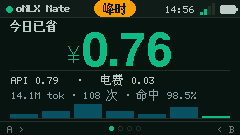
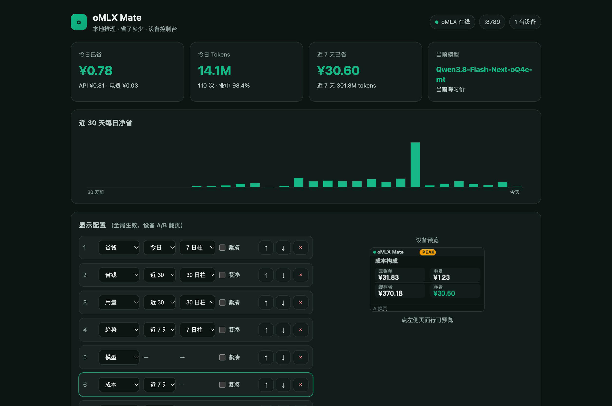

# oMLX Mate

> Your oMLX usage — and how much it saves — on a 240×135 desk display.

oMLX Mate is a desk companion for [oMLX](https://github.com/jundot/omlx) users. A Mac-side agent reads `~/.omlx/usage.sqlite3`, converts tokens into a DeepSeek API bill (peak/off-peak + cache-hit pricing), and pushes a <2 KB snapshot to an M5StickS3 every 5 seconds.

The device only renders; the Mac is the data core. oMLX never has to listen on the LAN.



## Features

- **Push, not pull** — no exposed inference port, no Mac IP to configure on the device
- **One-line install** — the device serves `/setup.sh` and `/agent.py`; `curl | bash` installs a LaunchAgent
- **Local console** — usage/savings KPIs, 30-day chart, display config with a 240×135 preview, remote device control
- **Configurable screens** — savings / usage / trend / models / cost / device; global config, A/B page switching on device
- **Bilingual** — Chinese and English
- **Offline tolerant** — device keeps last data; Mac keeps computing; reconnect and it catches up

## Quick start

1. Flash `releases/omlx-mate-v0.2.1-merged.bin` (M5Burner or `esptool`), or `pio run -e sticks3 -t upload`.
2. Power on. Scan the QR code, join `oMLX-Mate-XXXX` (password `omlxmate`), open `http://192.168.4.1`, enter your 2.4 GHz Wi-Fi.
3. The device shows `http://omlx-mate-xxxx.local`. Open it on the Mac and run:

```bash
curl -sL http://omlx-mate-xxxx.local/setup.sh | bash
```

4. Data appears within seconds. The console is at `http://127.0.0.1:<auto port>` (also written to `~/.omlx-mate/url.txt`).

Requirements: macOS, Python 3.9+, oMLX started at least once.

## Console



- Savings / tokens / cache hit for today, 7 days, 30 days
- 30-day daily savings chart
- Display config with live device preview; global for all devices
- Device cards: online, battery, Wi-Fi, current page; page / identify / reboot / remove
- Pricing settings: flash vs pro, currency, power, device depreciation, push interval

## Data & privacy

- Agent opens `usage.sqlite3` **read-only**
- Console binds to `127.0.0.1` by default; LAN access is opt-in with an access code
- Pushes stay on the LAN and carry a per-device token
- Nothing is sent to the cloud

## Build

```bash
pio run -e sticks3
python3 agent/omlx_mate_agent.py --once
bash tools/make_release.sh
python3 scripts/shot.py /dev/cu.usbmodem101 shot.png
```

`tools/embed_assets.py` embeds the latest agent and installer scripts into the firmware at build time, so the device always serves the newest agent.

## Known limitations

- macOS agent only
- Chinese holiday table is 2026-specific
- OTA partition exists; one-click firmware update from the console is not implemented yet

## License

MIT. `tools/check_merged.py` is reused from [Hermes Mate](https://github.com/andjiang0083/hermes-mate) (MIT).
